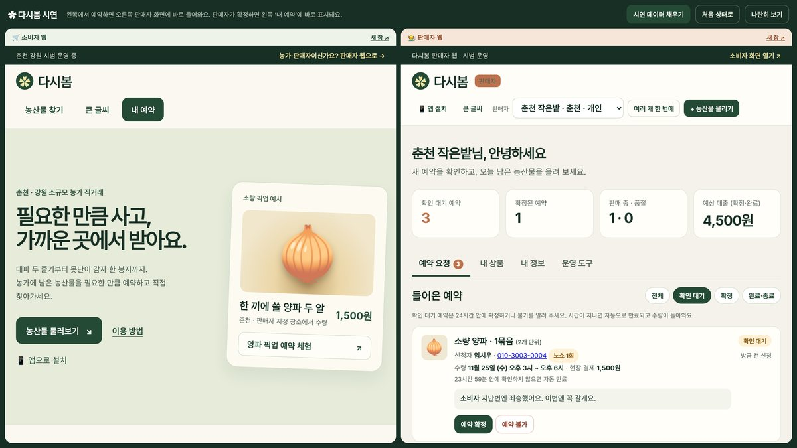
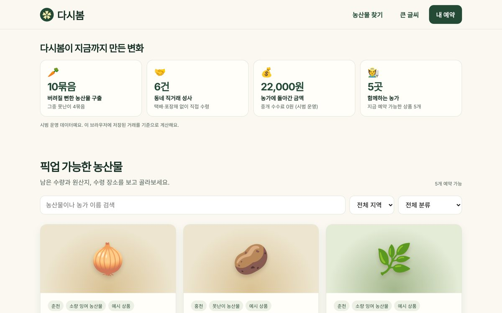
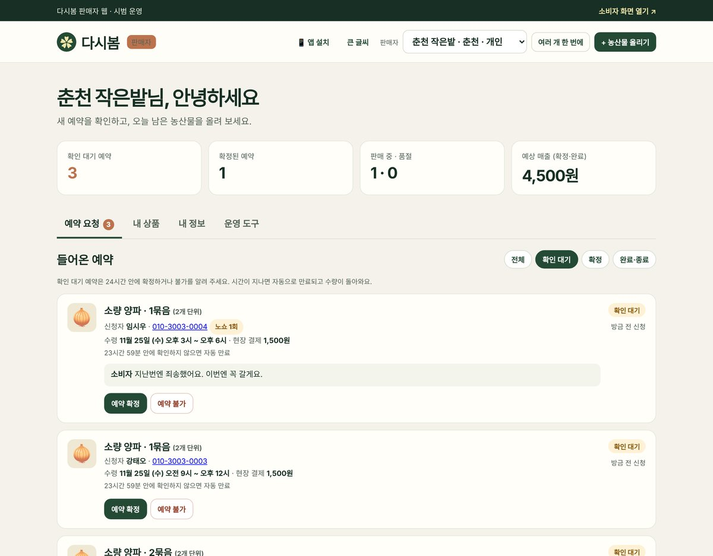
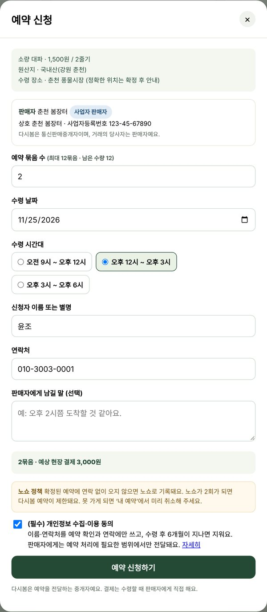
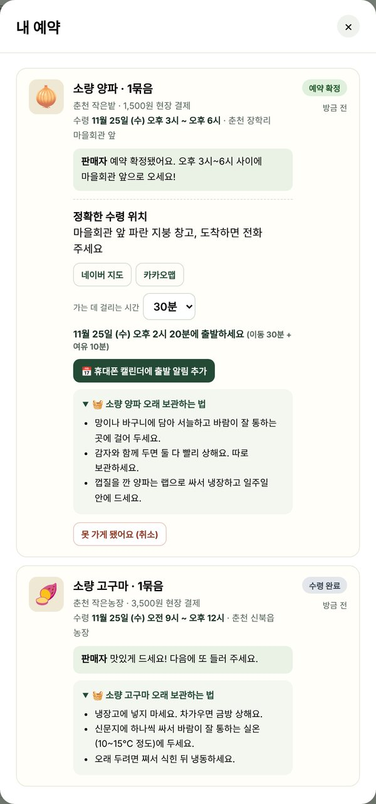
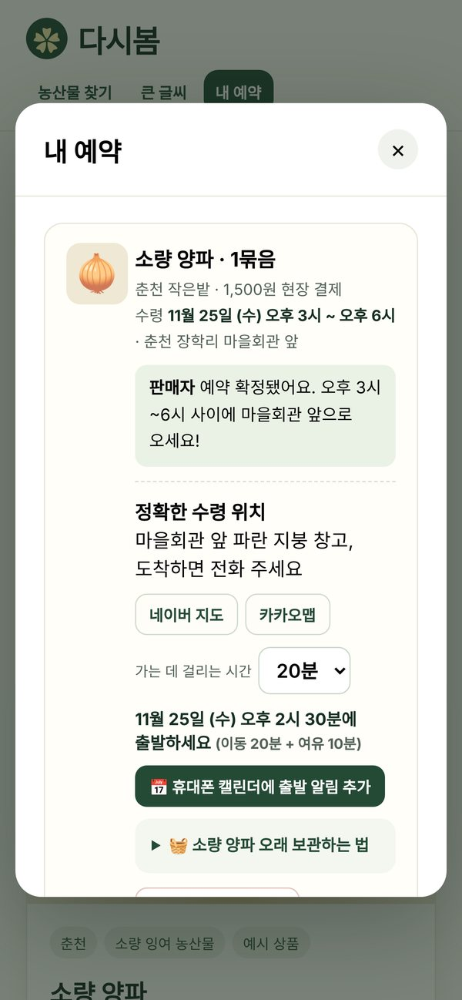
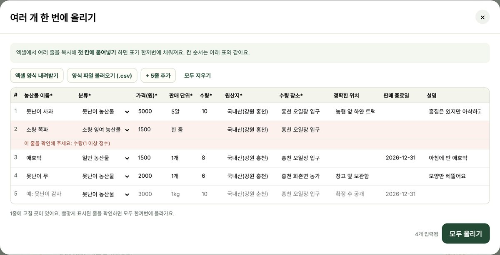

# 다시봄 🌱

**못난이 농산물의 가치를 다시 보다.**
춘천·강원 소규모 농가에 남은 못난이·잉여 농산물을, 동네 소비자가 **필요한 만큼 예약하고 가까운 곳에서 직접 받아 가는** 직거래 중개 서비스예요.

| 바로 보기 | 주소 |
|---|---|
| 🎬 시연 화면 (소비자·판매자 나란히) | https://notme624.github.io/dasibom/demo.html |
| 🛒 소비자 웹 | https://notme624.github.io/dasibom/ |
| 🧑‍🌾 판매자 웹 | https://notme624.github.io/dasibom/seller.html |
| 📄 이용약관·개인정보 처리방침 (초안) | https://notme624.github.io/dasibom/terms.html |

> 시연 화면 위쪽의 **‘시연 데이터 채우기’**를 누르면 수령 완료·확정·확인 대기·노쇼 예약이 채워져 모든 기능을 한눈에 볼 수 있어요.



## 왜 필요한가

- **1인 가구 804만 5천 가구, 전체의 36.1%** (2024년 기준, 국가데이터처). 강원은 39.4%로 전국에서 세 번째로 높아요. 마트의 큰 포장 단위는 소량 소비자에게 부담이에요.
- **비규격(못난이) 농산물은 전체 물량의 10~20%** (aT). 맛과 영양은 같지만 정상 유통이 어려워 폐기되거나 헐값에 팔려요.
- **고령·소규모 농가**는 온라인 판매가 어렵고, 소량을 자주 팔 판로가 부족해요.

다시봄은 **소량 단위 예약 + 동네 픽업 + 현장 결제**로, 택배·포장·온라인 결제 없이 농가와 소비자를 바로 이어요.

## 주요 기능

| 소비자 | 판매자 | 운영 |
|---|---|---|
| 남은 수량·원산지·판매자 유형을 보고 고르기 | **일반(개인 농가)/사업자 판매자** 2종류로 참여 | 성과 지표 (구출한 농산물, 거래, 참여 농가, 노쇼율) |
| 수령 날짜·시간대 골라 예약, 개인정보 동의 | **엑셀처럼 여러 개 한 번에 올리기** (붙여넣기·양식 파일) | 노쇼 2회 자동 예약 제한, 운영자 제한·해제 |
| 확정되면 정확한 위치 공개, 네이버·카카오 지도 | 상품 사진, 다시 올리기, 수량 변경, 판매 종료일 | 판매자별 차단 |
| **이동 시간에 맞춘 출발 알림** (휴대폰 캘린더) | 예약 확정·불가·수령 완료·**노쇼 기록** | 통신판매중개자 고지, 원산지 표시제도 안내 확인 기록 |
| **품목별 보관법** 안내 | 확인 대기 24시간 자동 만료, 수량 자동 복원 | 데이터 내려받기, 시연 초기화 |
| 큰 글씨 모드, **앱처럼 설치 (웹앱)** | 큰 글씨 모드, 판매자 앱 설치 | |

<p>
  
  
</p>
<p>
  
  
  
</p>



## 구조

```
index.html        소비자 웹
seller.html       판매자 웹 (운영 도구 포함)
demo.html         시연 화면: 소비자·판매자 나란히
terms.html        중개자 고지, 이용약관·개인정보 처리방침 초안, 노쇼 정책
assets/store.js   두 웹이 함께 쓰는 데이터 창고 + 운영 규칙(POLICY)
assets/style.css  공통 디자인
manifest.webmanifest, seller.webmanifest, sw.js   웹앱(홈 화면 설치)
```

- **기술**: HTML, CSS, JavaScript (프레임워크 없음), 브라우저 저장소(localStorage), 서비스 워커, GitHub Pages
- **지금의 한계**: 서버가 없어 **같은 기기·같은 브라우저 안에서만** 소비자와 판매자 화면이 연결돼요. 시연은 `demo.html`에서 하면 돼요.
- **다음 단계**: 클라우드 서버를 붙이면 `assets/store.js`의 함수만 서버 API로 바꾸면 돼요. (데이터 구조·API 대응표는 기획서의 ‘백엔드 설계도’)

## AI 활용

기획부터 구현까지 AI(Claude)와 함께 진행했어요.

- **기획·조사**: 서비스 기획서, 법·제도 조사(통신판매중개, 원산지 표시제도 고지 의무, 개인정보), 운영 리스크와 해결 방향 정리
- **개발**: 소비자·판매자 웹, 일괄 등록, 노쇼·차단 규칙, 출발 알림, 웹앱 구현과 브라우저 자동 테스트
- **향후 서비스 안 AI 기능 (계획)**: 사진 한 장으로 상품명·분류·설명 자동 작성, 시세 기반 가격 추천, 품목별 보관법·레시피 추천

## 향후 계획

1. 클라우드 서버 연결: 서로 다른 기기 연결, 휴대폰 인증 로그인, 문자·알림톡
2. 춘천 시범 운영: 참여 농가 직접 섭외, 오일장·마을회관 공용 픽업 거점
3. 사업자등록·통신판매업 신고, 약관·처리방침 법률 검토
4. 앱 출시: 웹앱으로 반응을 확인한 뒤 앱스토어

---
마이 AI 랩(My AI Lab) 프로젝트 · 시범 프로젝트로, 실제 거래는 이루어지지 않아요.
